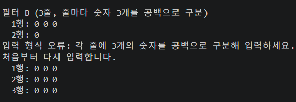
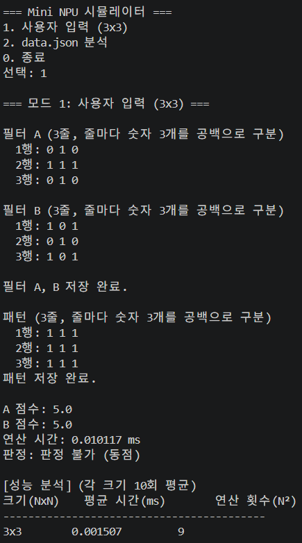
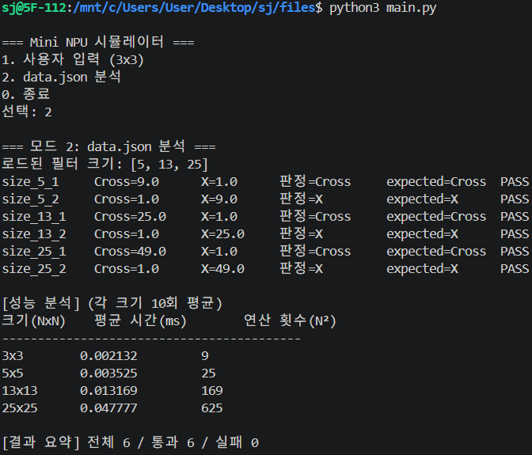
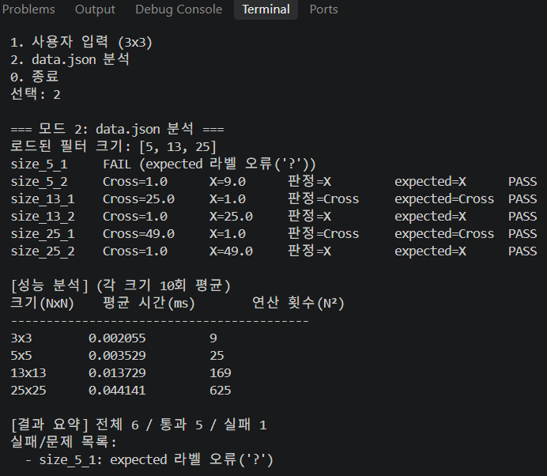
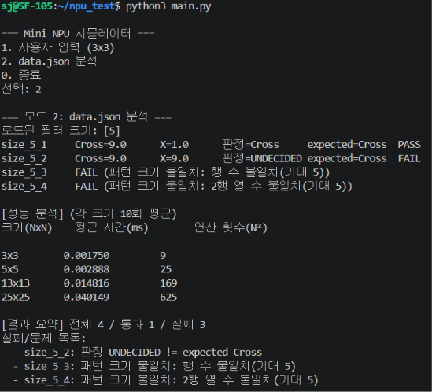
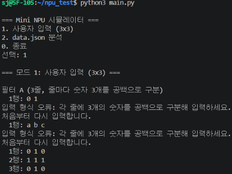
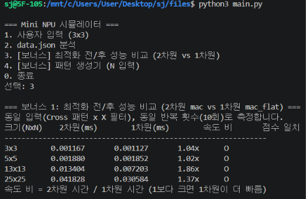
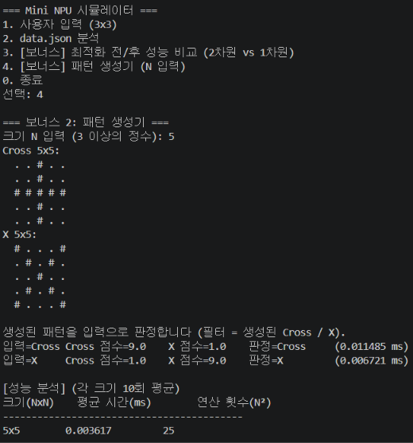
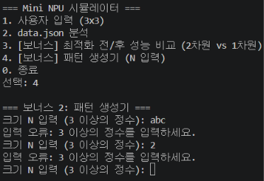

# Mini NPU 시뮬레이터

MAC(Multiply-Accumulate) 연산으로 3×3 ~ 25×25 패턴이 **Cross(십자가)** 인지 **X** 인지 판별하는 Python 콘솔 앱입니다. 표준 라이브러리(`json`, `time`, `re`, `os`)만 사용합니다.

## 실행 방법
```bash
python main.py
```
- 메뉴에서 `1` = 사용자 입력(3×3), `2` = data.json 분석, `3` = [보너스] 최적화 전/후 비교, `4` = [보너스] 패턴 생성기, `0` = 종료
- `data.json` 은 `main.py` 와 같은 폴더에 둡니다.
- 모드 1 예시 입력 (필터 A = 십자가, 필터 B = X, 패턴 = 십자가)
  ```
  0 1 0 / 1 1 1 / 0 1 0     (A)
  1 0 1 / 0 1 0 / 1 0 1     (B)
  0 1 0 / 1 1 1 / 0 1 0     (패턴)
  ```
  → A 점수 5, B 점수 1, 판정 A


## 요구사항 체크리스트

| 번호 | 구분 | 구현 위치 | 상태 |
|---|---|---|---|
| 01 | 데이터 구조 (n×n 2차원 리스트, 3/5/13/25) | `generate_cross`, `generate_x`, `m[i][j]` | ✅ |
| 02 | 입력 처리 + 형식 오류 시 재입력 | `read_matrix`, `mode_user` | ✅ |
| 03 | data.json 로드, size_N 추출, 크기 검증 | `mode_json`, `load_filters`, `validate_matrix`, `run_case` | ✅ |
| 04 | 라벨 정규화 (+/cross → Cross, x → X) | `normalize_label` | ✅ |
| 05 | MAC 연산 (반복문, 외부 라이브러리 금지) | `mac` | ✅ |
| 06 | epsilon 비교와 A/B/UNDECIDED 판정, PASS/FAIL | `is_tie`, `judge`, `run_case` | ✅ |
| 07 | 크기별 10회 평균 시간(ms)과 N² 표 | `measure_ms`, `print_perf_table` | ✅ |
| 08 | 전체/통과/실패 수와 실패 사유 | `mode_json` | ✅ |
| 09 | 실행 흐름 (선택 → 입력/로드 → MAC → 판정 → 성능 → 요약) | `main` | ✅ |
| 보너스 1 | 2차원 → 1차원 변환 및 최적화 전/후 비교 | `flatten`, `mac_flat`, `mode_compare` | ✅ |
| 보너스 2 | 패턴 생성기, 모드·성능 분석 재활용 | `generate_cross/x`, `mode_generator`, `measure_ms` | ✅ |


## 설계 트리

```
main.py
├─ 라벨/패턴 도구
│   ├─ normalize_label()      표기 통일 (+, cross → Cross / x → X)
│   ├─ generate_cross(n)      N×N 십자가 생성
│   └─ generate_x(n)          N×N X 생성
├─ 연산/판정
│   ├─ mac()                  위치별 곱셈 후 누적 (이중 for문)
│   ├─ mac_flat()             1차원 버전 (보너스)
│   ├─ is_tie()               abs(a-b) < 1e-9
│   └─ judge()                A/B 또는 Cross/X 또는 UNDECIDED
├─ 성능
│   ├─ measure_ms()           10회 평균(ms), 연산 구간만 측정
│   └─ print_perf_table()     크기 / 평균 시간 / N² 표
├─ 모드 1 (사용자 입력)
│   ├─ read_matrix()          한 줄씩 입력, 오류 시 재입력
│   └─ mode_user()
├─ 모드 2 (data.json)
│   ├─ validate_matrix()      크기·숫자 검증 → 사유 문자열
│   ├─ load_filters()         size_N 필터 로드 + 라벨 정규화
│   ├─ run_case()             한 케이스 판정, 예외 없이 (PASS/FAIL, 사유)
│   └─ mode_json()            전체 실행 + 요약
├─ 보너스
│   ├─ flatten()              2차원 → 1차원(길이 N²) 변환
│   ├─ time_avg_ms()          워밍업 1회 후 10회 평균
│   ├─ mode_compare()         메뉴 3: 2차원 vs 1차원 비교 표
│   ├─ print_pattern()        패턴을 # 와 . 로 출력
│   └─ mode_generator()       메뉴 4: N 입력 → 패턴 생성 → 판정
└─ main()                     메뉴 선택
```


## 실행 흐름

```
메뉴 선택 ─┬─ 1) 사용자 입력: 필터 A, B 입력 → 저장 확인 → 패턴 입력
           │      → MAC 연산 → 판정(A / B / 판정 불가) → 성능 분석(3×3)
           │
           ├─ 2) data.json: 필터 로드 → 패턴 로드/검증(크기, 라벨)
           │      → MAC 연산 / 판정 / PASS-FAIL 출력
           │      → 성능 분석(3, 5, 13, 25) → 결과 요약(전체/통과/실패/사유)
           │
           ├─ 3) [보너스] 최적화 비교: 동일 입력으로 2차원 vs 1차원 시간 비교
           │
           └─ 4) [보너스] 패턴 생성기: N 입력 → Cross/X 생성 → 판정 → 성능 분석(N×N)
                  
```


## 구현 요약
- **데이터 구조**: n×n 2차원 리스트(`list[list[float]]`). `m[i][j]` 로 읽기/쓰기.
- **라벨 정규화** (`normalize_label`): `'+'`, `'cross'` → `Cross`, `'x'` → `X` (대소문자/공백 무시). 알 수 없는 라벨은 `None` 으로 처리해 해당 케이스만 FAIL.
- **MAC 연산** (`mac`): 이중 for문으로 같은 위치끼리 곱해 누적. 외부 라이브러리 없음.
- **동점 처리**: `abs(a - b) < 1e-9` 이면 동점 → `UNDECIDED` (모드 1에서는 "판정 불가").
- **입력 검증**: 모드 1은 열 개수·숫자 파싱 오류 시 안내 문구 출력 후 재입력. 모드 2는 스키마·크기 불일치를 케이스 단위 FAIL로 처리하며 프로그램은 종료되지 않음.
- **보너스(완성)**: 메뉴 3 에서 2차원 `mac` 과 1차원 `mac_flat` 을 동일 입력·동일 10회 반복으로 비교하고, 메뉴 4 에서 N 을 입력받아 Cross/X 패턴을 생성·출력한 뒤 그 패턴을 필터와 입력으로 재사용해 판정한다. 생성기(`generate_cross`, `generate_x`)는 성능 분석(`measure_ms`)에서도 재사용한다.


## 실행 결과 화면

### 1) 모드 1 - 입력 형식 오류와 재입력
필터 B 2행에 숫자를 1개만 입력하면 안내 문구가 출력되고 처음부터 다시 입력받는다.



### 2) 모드 1 - 동점(판정 불가)
십자가 필터 A, X 필터 B에 전부 1인 패턴을 넣으면 두 점수가 5.0으로 같아 "판정 불가 (동점)"이 출력된다.



### 3) 모드 2 - 정상 실행 (전체 6 / 통과 6 / 실패 0)
케이스별 판정, expected 비교(PASS), 성능 분석 표, 결과 요약이 출력된다.



### 4) 모드 2 - 의도적 오류 케이스 (FAIL 처리)
`size_5_1` 의 expected 를 `?` 로 바꿔 실행했다. 프로그램이 멈추지 않고 해당 케이스만 FAIL 로 집계된다(전체 6 / 통과 5 / 실패 1).




## 추가 검증 결과

### 크기 불일치와 UNDECIDED (모드 2)
`size_5_2` 는 전부 1인 패턴이라 Cross·X 점수가 9.0 으로 같아 UNDECIDED 가 나오고, expected 와 달라 FAIL 로 집계된다. `size_5_3` 은 3×3 패턴을 size_5 에 넣은 경우, `size_5_4` 는 2행 열 수가 4인 경우로 둘 다 "패턴 크기 불일치"로 FAIL 처리되며 프로그램은 끝까지 실행된다.



### 열 개수 불일치와 숫자 파싱 실패 (모드 1)
숫자를 2개만 넣거나 `a b c` 처럼 숫자가 아닌 값을 넣으면 같은 안내 문구가 출력되고 다시 입력받는다.



## 보너스 결과

### 최적화 전/후 비교 (2차원 vs 1차원)
동일 입력(Cross 패턴 × X 필터)과 동일 반복 횟수(10회)로 측정했고, 두 방식의 점수가 모두 일치함을 확인했다.



2차원 접근은 `p[i][j]`, `f[i][j]` 처럼 칸마다 인덱싱을 두 번씩 하지만, 1차원은 `p[k]`, `f[k]` 로 한 번씩만 하므로 접근 패턴이 단순해진다. 측정 결과 모든 크기에서 1차원이 같거나 빨랐고, 특히 13×13(약 1.9배)과 25×25(약 1.4배)에서 차이가 뚜렷했다. 3×3, 5×5 는 시간이 매우 짧아 차이(약 1.0배)가 측정 잡음 수준이었다. 값은 실행마다 달라지며, 두 방식 모두 곱셈 횟수가 N² 이므로 시간 복잡도는 O(N²) 로 같고 줄어드는 것은 상수 비용이다.

### 패턴 생성기
N 을 입력하면 N×N Cross 와 X 를 생성하고, 생성된 패턴을 필터와 입력으로 재사용해 판정한다.






## 결과 리포트
### 실행 결과 (샘플 data.json: 5/13/25 각 Cross·X 1개씩, 총 6케이스)
전체 6 / 통과 6 / 실패 0.

### 실패 원인 분석 (왜 0 FAIL 이 되었나)
1. 실패는 "데이터/스키마", "로직", "수치 비교" 세 갈래로 나눠 진단했다.
2. 데이터/스키마: expected 는 `+`/`x`, 필터 키는 `cross`/`x` 로 표기가 서로 달라 그대로 비교하면 항상 FAIL 이 된다. 내부에서 `Cross`/`X` 로 정규화해 비교하니 라벨 불일치가 사라졌다.
3. 데이터/스키마: 패턴 키 `size_N_idx` 에서 N 을 추출해 같은 크기의 필터를 고르고, 행/열 크기를 검증한다. 크기가 어긋나면 크래시 대신 FAIL + 사유("패턴 크기 불일치")로 기록한다.
4. 의도적 오류 테스트: expected 를 `?` 로 바꾸면 위 4번 화면처럼 해당 케이스만 FAIL 로 집계되고 프로그램은 끝까지 실행됐다.
5. 로직: 필터에 맞는 패턴이면 점수가 (한 줄 길이×2−1)로 가장 크고, 반대 필터와는 겹치는 중앙 1칸만 곱해져 1점이 된다(5×5: 9 vs 1). 점수 차이가 커서 판정이 안정적이다.
6. 수치 비교: 점수는 float 라서 `0.1+0.2 == 0.3` 처럼 `==` 비교는 오차 때문에 동점이 거짓으로 판정될 수 있다. 그래서 `abs(a-b) < 1e-9` 를 동점으로 보는 epsilon 정책을 썼다.
7. 샘플 데이터는 정수 0/1 이라 오차가 거의 없지만, 소수 값 데이터가 들어와도 같은 정책으로 안전하게 동작한다.


### 성능 분석 및 시간 복잡도 (10회 평균, 실행 환경에 따라 값은 다름)

| 크기 | 평균 시간(ms) | 연산 횟수(N²) |
|---|---|---|
| 3×3 | 0.0021 | 9 |
| 5×5 | 0.0035 | 25 |
| 13×13 | 0.0132 | 169 |
| 25×25 | 0.0478 | 625 |

8. MAC 은 N×N 위치를 한 번씩 곱하고 더하므로 곱셈 횟수가 정확히 N² 이다. 즉 시간 복잡도는 **O(N²)**.
9. 3×3 → 25×25 로 N 은 약 8.3배, 연산 횟수는 9 → 625 로 약 69배 늘었다. 측정 시간도 약 0.0021 → 0.0478 ms 로 약 22배 증가해, 크기가 커질수록 연산량에 따라 시간이 늘어나는 경향을 확인했다. 작은 크기에서는 함수 호출·타이머 오버헤드가 비중이 커서 배율이 이론값보다 작게 나온다.
10. 시간은 I/O 를 제외하고 `mac` 호출 구간만 `time.perf_counter()` 로 측정했고, 일회성 편차를 줄이려 10회 평균을 썼다. 실행할 때마다 값이 조금씩 달라지는 것은 정상이다.
11. CPU 는 이 N² 번의 곱셈을 순차로 처리하지만 NPU 는 병렬 MAC 유닛으로 한꺼번에 처리한다. 필터가 크고 많아질수록 이 차이가 커서 NPU 가 필요해진다.